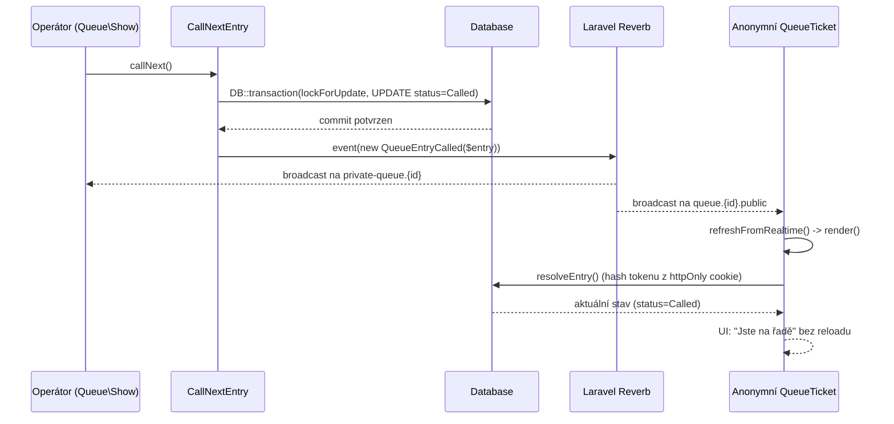

# Realtime (Laravel Reverb) — analýza a implementační plán

> Stav: **analýza dokončena, implementace nezačata.** Nic z tohoto dokumentu
> ještě nebylo provedeno v kódu — jde čistě o plán k realizaci po krocích
> (sekce 18 obsahuje checklist v pořadí).

---

## 1. Aktuální realtime stav projektu

**V projektu AKTUÁLNĚ JE:**

- Laravel `v13.32.0` (composer.lock), Livewire `v4.4.5`, Laravel Reverb `v1.11.1`, `pusher/pusher-php-server` `7.3.0` — všechno nainstalováno (`composer.json:10-18`).
- `routes/channels.php:5-7` — jediný definovaný broadcast channel je vestavěný Laravel `App.Models.User.{id}` z `laravel/livewire-starter-kit`. **Žádný channel pro queue/entry/session neexistuje.**
- `bootstrap/app.php:13` — `withRouting(..., channels: __DIR__.'/../routes/channels.php', ...)` — broadcasting routing je zapnuté a připravené.
- `resources/js/echo.js:1-19` — kompletně nakonfigurovaný `window.Echo` s `laravel-echo` + `pusher-js`, broadcaster `reverb`, čte `VITE_REVERB_*` env proměnné, navíc řeší offline/online (`window.Echo.disconnect()` / `connect()`).
- `resources/js/app.js:1` — `echo.js` je importován, takže `window.Echo` běží na každé stránce, i když ho dnes nikdo nepoužívá.
- **Nikde v `app/` neexistuje žádný `Broadcast`, `ShouldBroadcast(Now)`, `broadcast(...)`, `broadcastOn/As/With`, `InteractsWithSockets`, `->channel(`, `->private(`, `->presence(`** — ověřeno gruntovním grepem přes celý `app/`.
- **Neexistují** `app/Events/*`, `app/Listeners/*`, `app/Observers/*`, `app/Jobs/*`, `app/Notifications/*` — všechny tyto adresáře jsou prázdné/neexistují (prázdné výsledky Glob).
- `app/Providers/AppServiceProvider.php` a `FortifyServiceProvider.php` jsou jediné providery; žádný z nich neregistruje broadcasting, žádný `BroadcastServiceProvider` override.
- Jediné tři realtime-relevantní UI prvky v projektu dnes fungují výhradně přes `wire:poll` (viz sekce 2).

**Shrnutí:** Reverb je plně *nakonfigurovaný a běžící* (lokálně), ale *broadcasting infrastruktura v doméně je nulová* — žádný event, listener, observer. Je to čistý start „on-top" existujícího stabilního checkpointu.

---

## 2. Co dnes používá polling

| Komponenta | Soubor | Polling | Účel | Lze odstranit? |
|---|---|---|---|---|
| `App\Livewire\Public\QueueTicket` | `resources/views/livewire/public/queue-ticket.blade.php:1` — `wire:poll.4s.visible` | 4 s, jen když je tab viditelný | Zjistit změnu statusu vlastního lístku (`waiting→called→completed/...`) a pozici ve frontě | Ano, po zavedení Reverb — toto je hlavní cíl celého úkolu |
| `App\Livewire\Queue\Show` | `resources/views/livewire/queue/show.blade.php:17` — `wire:poll.4s.visible` | 4 s, jen při viditelnosti | Operátorská konzole — vidět nové joiny, akce jiných operátorů, změny service pointů | Ano, z velké části — zůstane jako fallback (viz sekce 11) |
| `App\Livewire\Dashboard\QueueOverviewTable` | `resources/views/livewire/dashboard/queue-overview-table.blade.php:1` — `wire:poll.10s.visible` | 10 s, jen při viditelnosti | Přehled všech front uživatele — stav session, počet čekajících, počet service pointů | Ano, s nižší prioritou (dashboard je nejméně time-critical) |

Všechny tři už používají `.visible` modifikátor (polling se zastaví, když je tab na pozadí).

`App\Livewire\Queue\Settings` a `App\Livewire\Queue\TeamAccess` **nemají** `wire:poll` — formulářové/administrační obrazovky bez realtime potřeby, nejsou předmětem tohoto plánu.

---

## 3. Současná Reverb/Broadcast konfigurace

**Composer (ověřeno `composer.json` + `composer.lock`):**
- `laravel/reverb: *` → nainstalováno `v1.11.1` ✅
- `pusher/pusher-php-server: *` → `7.3.0` ✅
- `laravel/framework: ^13.17` → nainstalováno `13.32.0` ✅
- `livewire/livewire: ^4.1` → nainstalováno `v4.4.5` ✅

**Frontend (`package.json`):**
- `devDependencies`: `laravel-echo: ^2.5.0`, `pusher-js: ^8.6.0` ✅ — pozor, jsou v `devDependencies`, ne `dependencies`; funkčně to v buildu nevadí, ale stojí za zvážení přesunout do `dependencies`.

`config/broadcasting.php:18` — `'default' => env('BROADCAST_CONNECTION', 'null')`, `reverb` connection nakonfigurovaná (`:33-47`).

`config/reverb.php` — existuje, kompletní: `servers.reverb` (host `0.0.0.0`, port `8080` fallback, scaling přes Redis vypnuté), `apps.apps[0]` s rate limitingem (vypnutý defaultně).

**`.env` vs `.env.example`:** Stejná sada klíčů existuje v obou, žádná nesrovnalost nalezena: `BROADCAST_CONNECTION`, `QUEUE_CONNECTION`, `CACHE_STORE`, `REVERB_APP_ID/KEY/SECRET`, `REVERB_HOST/PORT/SCHEME`, `REVERB_SERVER_HOST/PORT`, `VITE_REVERB_APP_KEY/HOST/PORT/SCHEME` — všechno nastaveno lokálně na `localhost`/`http`/port `6001`. Produkční varianta bude muset mít `REVERB_SCHEME=https`.

`config/queue.php:16` — `QUEUE_CONNECTION=database`. `config/cache.php:18` — `CACHE_STORE=database` (není Redis → `config/reverb.php` scaling zůstává vypnuté, v pořádku pro aktuální rozsah).

**Lokální spouštění (`package.json:5`)** — `npm run dev` už spouští `php artisan serve` + `php artisan reverb:start` + `php artisan queue:listen` + Vite souběžně. **Není potřeba nic instalovat ani konfigurovat navíc pro lokální vývoj.**

**Chybí:** žádné eventy/listenery/broadcasty v doméně, žádný queue-specifický channel v `routes/channels.php`.

---

## 4. Domain mutations

| Action | Co mění | Koho změna zajímá | Potenciální broadcast |
|---|---|---|---|
| `JoinQueue` (`JoinQueue.php:23-65`) | Vytvoří `QueueEntry` (Waiting), inkrementuje `next_number`, zapíše `QueueEntryStatusChange` | Operátorská konzole, Dashboard | `QueueEntryJoined` |
| `CallNextEntry` (`CallNextEntry.php:24-67`) → `transition()` | `Waiting→Called`, přiřadí `service_point_id` | Volaný návštěvník, ostatní čekající, operátoři | `QueueEntryCalled` |
| `CompleteEntry` (`CompleteEntry.php:14-27`) → `transition()` | `Called→Completed` | Daný návštěvník, dashboard, service point se uvolní | `QueueEntryCompleted` |
| `CancelEntry` (`CancelEntry.php:15-28`) → `transition()` | `Waiting/Called→Cancelled` | Daný návštěvník, ostatní čekající | `QueueEntryCancelled` |
| `MarkEntryNoShow` (`MarkEntryNoShow.php:15-28`) → `transition()` | `Waiting/Called→NoShow` | Daný návštěvník, service point se uvolní | `QueueEntryMarkedNoShow` |
| `OpenQueueSession` (`OpenQueueSession.php:20-43`) | Vytvoří novou `QueueSession` (Open) | Veřejný ticket, operátoři, dashboard | `QueueSessionOpened` |
| `PauseQueueSession` (`PauseQueueSession.php:15-31`) | `Open→Paused` | Veřejný ticket, operátoři | `QueueSessionPaused` |
| `ResumeQueueSession` (`ResumeQueueSession.php:14-30`) | `Paused→Open` | Veřejný ticket, operátoři | `QueueSessionResumed` |
| `CloseQueueSession` (`CloseQueueSession.php:15-35`) | `→Closed`, `closed_at`, `closed_by_user_id` | Veřejný ticket, operátoři, dashboard | `QueueSessionClosed` |
| `SelectServicePointToCall` (`SelectServicePointToCall.php:22-62`) | Čistě výpočetní, nic nemutuje | — | žádný |

**Mutace mimo Actions** (upozornění):
- `App\Livewire\Queue\Show::addServicePoint()` (`Show.php:206-228`) — vytváří `ServicePoint` přímo, mimo `app/Actions/Queue/`.
- `App\Livewire\Queue\Show::toggleServicePoint()` (`Show.php:230-241`) — `update()` přímo, mimo Actions.
- `App\Livewire\Dashboard\QueueOverviewTable::createQueue()` (`QueueOverviewTable.php:30-50`) — `VirtualQueue::create()` přímo v komponentě.

Tyto tři nejsou realtime-kritické v prvním kole — k rozhodnutí později, mimo rozsah tohoto plánu.

---

## 5. Doporučený event model

**Varianta A — specifické eventy** (`QueueEntryJoined/Called/Completed/Cancelled/MarkedNoShow`, `QueueSessionOpened/Paused/Resumed/Closed`): přesné payloady, dobrá testovatelnost, ale 9 tříd.

**Varianta B — obecné eventy** (`QueueEntryChanged`, `QueueSessionChanged`): minimum kódu, ale klient neví co přesně se stalo, horší testovatelnost, hůř obhajitelné u maturity.

**Doporučený hybrid:** malá pevná sada **specifických** eventů (1 třída per mutace z sekce 4 = 9 tříd), všechny implementují společný interface/trait pro sdílenou broadcast/payload logiku — žádná duplicita, ale zachovaná přesnost názvů pro testy i dokumentaci. Žádná CQRS/event sourcing abstrakce.

---

## 6. Channel architecture

| Channel pattern | Typ | Kdo poslouchá | Autorizace | Co se posílá | Proč takto |
|---|---|---|---|---|---|
| `private-queue.{virtualQueueId}` | private | `Queue\Show`, `QueueOverviewTable` | `Broadcast::channel('queue.{id}', fn($user,$id) => $user->canViewQueue(...))` reuse `User::canViewQueue()` (`User.php:140-143`) | Všechny entry/session eventy dané fronty | `virtualQueueId` je stejně dnes veřejně viditelné (sekce 7), autorizace přesně odpovídá tomu, kdo konzoli/dashboard vidí |
| `queue.{virtualQueueId}.public` | public | Anonymní `QueueTicket` | žádná (public channel) | Jen agregátní signály (session status, žádná entry data) | Veřejný kanál nesmí nést nic o jednotlivých lístcích |

Žádné per-entry/per-ticket channel jako primární mechanismus (sekce 7). Žádné presence channels (zbytečná složitost pro tento rozsah).

---

## 7. Bezpečnost anonymního QueueTicketu

**Ověřený současný stav:**
- Token vzniká: `TrackingToken::generate()` (`TrackingToken.php:23-28`) — 256 bitů z `random_bytes()`.
- DB ukládá jen `tracking_token_hash` (SHA-256), nikdy raw (`TrackingToken.php:33-36`, `QueueEntry.php:29`).
- Dohledání: `QueueEntry::where('tracking_token_hash', TrackingToken::hash($this->token))` (`QueueTicket.php:91-95`).
- Token žije v httpOnly cookie `noq_ticket_{virtualQueueId}` (`QueueTicket.php:62-67`, `103-106`), 12h TTL.

**Důležité zjištění:** `QueueTicket::$token` je **public Livewire property** (`QueueTicket.php:31`) → Livewire serializuje ji do klientského JSON snapshotu (čitelné ve view-source/devtools), i když zároveň žije v httpOnly cookie. To je existující stav projektu, ne něco zaváděné realtime řešením — ale je důležitý kontext: hranice "token nikdy do JS" je v projektu už dnes měkčí, než čistě httpOnly-only design by předpokládal. Realtime řešení nemá tuto expozici dále zvětšovat.

Dále `:virtual-queue="$virtualQueue"` (`queue-public.blade.php:7`) pravděpodobně serializuje i interní `VirtualQueue.id` do klientského JSON (**JE POTŘEBA OVĚŘIT** přímým pohledem na vygenerované HTML) — i kdyby ano, numerické ID fronty není tajemství.

**Porovnání variant:**
- **A) Veřejný queue-wide channel, minimum dat** — žádná enumerace, žádný leak ID/tokenu, token nikdy nejde do JS kvůli WS. Triviální škálování.
- **B) Private per-ticket channel s autentizací anonyma** — vyžadoval by token v JS pro `/broadcasting/auth`, což porušuje httpOnly hranici. Nežádoucí.
- **C) Opaque subscription identifier odvozený od tokenu** — funkční, ale přidaná komplexita navíc řešící problém, kterému se varianta A vyhne úplně.

**Finální doporučení — hybrid A + server-side re-fetch:**
1. Veřejný kanál `queue.{virtualQueueId}.public` nese jen signál „stav se změnil" — žádná entry-specifická data.
2. `QueueTicket` po signálu vždy znovu načte vlastní stav přes `resolveEntry()` (hash tokenu, nikdy neopustí server).
3. Klient se nikdy nepřihlašuje na channel specifický pro svůj ticket → token se nikdy nestane součástí channel jména/auth payloadu.
4. Nevýhoda (přijatelná): každý ticket dostane broadcast při každé změně na frontě, i cizí — stejný princip jako dnešní `wire:poll`, jen instantní místo intervalu.

---

## 8. Event payloady

**A) plný stav vs. B) invalidation signál + server-side refresh** — doporučeno **B pro všechno**, s minimálním payloadem navíc jen kde UX vyžaduje identifikaci řádku (operátorská konzole potřebuje `entry_id` pro zvýraznění/odstranění řádku; veřejný ticket nikdy nedostává entry-specifická data).

Konkrétně:
- `QueueEntryCalled` → `{ entry_id, service_point_name }` (jen na private kanál pro operátory).
- `QueueEntryCompleted/Cancelled/MarkedNoShow` → `{ entry_id }` (jen private kanál).
- `QueueEntryJoined` → `{}` nebo `{ waiting_count }` (agregát, bezpečný).
- `QueueSessionOpened/Paused/Resumed/Closed` → `{ status }`.

**Nikdy v payloadu:** `tracking_token_hash`, raw token, osobní údaje (žádné neexistují u `QueueEntry`), celý serializovaný Eloquent model.

Race condition (sekce 11 zadání, "#4 → odejdou 2 lidé → musí se zobrazit #2") je vyřešena tím, že `position()` (`QueueEntry.php:76-83`) se vždy dopočítává z DB při každém re-renderu — nikdy se nepočítá na klientovi ani nenese v payloadu.

---

## 9. Livewire integrace

Ověřeno v `vendor/livewire/livewire/dist/livewire.js` (Livewire v4.4.5): syntaxe `#[On('echo:channel,Event')]` / `echo-private:` / `echo-presence:` / `echo-notification:` je **nezměněná oproti Livewire 3** (kompilovaný kód parsuje `event.split(/(echo:|echo-)|:|,/)`).

**`QueueTicket`:**
```php
#[On('echo:queue.{virtualQueueId}.public,QueueSessionChangedSignal')]
public function refreshFromRealtime(): void {}
```

**`Queue\Show`:** devět `#[On('echo:queue.{virtualQueueId},QueueEntry...')]` atributů na jedné `refreshFromRealtime()` metodě (statický pattern per komponenta, jedna fronta).

**`QueueOverviewTable`:** vyžaduje `getListeners()` override (ne statické atributy), protože poslouchá *více* front najednou — mapa generovaná z `$this->allQueues`/`auth()->user()->virtualQueues`.

Po implementaci lze `wire:poll` u všech tří komponent de facto odstranit, ale doporučeno **neodstraňovat úplně** (sekce 11).

---

## 10. Transakce a after-commit

Ověřeno: **všechny** Actions v `app/Actions/Queue/` obalují logiku `DB::transaction()` (`JoinQueue.php:27`, `CallNextEntry.php:30`, `TransitionsQueueEntryStatus.php:29`, `OpenQueueSession.php:24`, `PauseQueueSession.php:19`, `ResumeQueueSession.php:18`, `CloseQueueSession.php:19`).

**Laravel 13 nabízí:** `ShouldDispatchAfterCommit` (marker interface na eventu) + `ShouldBroadcastNow`/`ShouldBroadcast` (queued).

**Doporučení:**
1. Dispatch eventu umístit **za** `DB::transaction()` volání v Action (ne uvnitř closure) — nejjednodušší, bez magie.
2. Navíc implementovat `ShouldDispatchAfterCommit` jako pojistku pro budoucí refaktoring/vnořené transakce.
3. **`ShouldBroadcastNow`** doporučeno (ne queued) — pro okamžitý UX bez závislosti na queue workeru. Trade-off: blokuje request operátora o čas HTTP volání k Reverb (v lokální síti zanedbatelné). **JE POTŘEBA OVĚŘIT** přesné chování při selhání broadcastu (riziko #2 v sekci 16) — obalit `try/catch`, aby výpadek Reverb nerozbil operátorovu akci.

---

## 11. Reconnect a fallback

**Princip:** DATABASE = source of truth, WEBSOCKET EVENT = jen trigger k re-fetchi. Nikdy se nedrží stav na klientovi samostatně.

| Scénář | Chování |
|---|---|
| Dočasný výpadek Reverb | `online`/`offline` listenery už existují (`echo.js:18-19`); navíc vynutit jeden refresh při `online`. |
| Uspání mobilu / PWA resume | `pusher-js` reconnect (exponenciální backoff) + fallback poll jako pojistka proti zmeškaným eventům. |
| Reconnect websocketu | Nativní `pusher-js` ping/pong (`activity_timeout` 30s, `ping_interval` 60s v `config/reverb.php`). |
| Wi-Fi → mobilní data | Totéž jako reconnect. |
| Reload stránky | `mount()` vždy čte aktuální stav z DB — vždy 100% konzistentní bez ohledu na realtime. |

**Finální doporučení:** Neodstraňovat `wire:poll` úplně — prodloužit interval ze 4s/10s na **30s** jako pomalý fallback proti tichému výpadku Reverb, který `online`/reconnect handlery nezachytí. Žádný vlastní replay/message queue mechanismus (enterprise overengineering).

---

## 12. PWA / Service Worker — vliv na realtime

Ověřeno (`public/sw.js:28-46`): service worker explicitně vynechává `navigate` requesty z cache (vždy network-first, fallback jen na `/offline.html`), cachuje jen statické assety. Komentář v kódu: *"Never cache sessions, queue state, API or Livewire responses."* → **Service worker nijak nekoliduje s realtime**, WebSocket spojení jde mimo fetch/cache lifecycle úplně.

**JE POTŘEBA OVĚŘIT** (nekritické): manifest/SW registrace scope, zda PWA "resume" z homescreen nenačítá stránku jinak než network-first (podle `sw.js` nepravděpodobné).

---

## 13. Testovací strategie

**A) Unit/Feature testy backend eventů** — `tests/Feature/Queue/Realtime/*BroadcastTest.php`, `Event::fake()` + assert dispatch, channel, payload, žádný dispatch při `QueueDomainException`, dispatch až po commitu.

**B) Authorization testy channelů** — `tests/Feature/Queue/Realtime/ChannelAuthorizationTest.php`: supervisor ano, přiřazený worker ano, cizí uživatel ne; veřejný kanál bez autorizace, ale payload nikdy citlivý.

**C) Livewire testy** — `Livewire::test(QueueTicket::class, ...)->call('refreshFromRealtime')->assertSee(...)`, rozšíření `tests/Feature/Public/QueueTicketComponentTest.php`.

**D) Browser/E2E** — projekt dnes nemá Dusk/Playwright; **neinstalovat nic nového** pro tento krok, Livewire testy + manuální scénář dostačují.

**E) Manuální scénář (2+ prohlížeče):**
1. Operátor (A) otevře `/queues/{id}`, otevře frontu.
2. Anonym (B) otevře `/q/{public_id}`, vstoupí do fronty.
3. A vidí nový řádek bez reloadu.
4. A klikne „Zavolat dalšího".
5. B vidí „Jste na řadě" bez reloadu.
6. A klikne „Dokončit".
7. B vidí „Obslouženo" bez reloadu.
8. A pozastaví frontu → třetí prohlížeč (C) na `/q/{public_id}` vidí „Pozastaveno" bez reloadu.
9. Vypnout/zapnout Wi-Fi na B → ověřit obnovu správného stavu po reconnectu.

---

## 14. První vertical slice — `CallNextEntry` → `QueueTicket`

1. **Action:** `App\Actions\Queue\CallNextEntry` (`app/Actions/Queue/CallNextEntry.php`) — jen přidat dispatch po `DB::transaction()`.
2. **Nový event:** `App\Events\Queue\QueueEntryCalled` — `ShouldBroadcastNow` + `ShouldDispatchAfterCommit`.
3. **Kde vznikne:** v `CallNextEntry::__invoke()`, po uložení výsledku transakce do proměnné, dispatch `event(new QueueEntryCalled($entry))`, pak `return $entry`.
4. **Odkud se dispatchne:** z Action, ne z Livewire komponenty.
5. **Kdy vzhledem k transakci:** striktně po úspěšném návratu z `DB::transaction()`.
6. **Channel:** `private-queue.{virtual_queue_id}` (operátoři) + `queue.{virtual_queue_id}.public` (veřejný ticket).
7. **Data:** `entry_id`, `service_point_name` na private kanálu; prázdný signál na public kanálu.
8. **Autorizace:** nová `Broadcast::channel('queue.{virtualQueueId}', fn (User $user, int $id) => ...$user->canViewQueue(...))` v `routes/channels.php`.
9. **Jak `QueueTicket` začne poslouchat:** `#[On('echo:queue.{virtualQueueId}.public,QueueEntryCalled')]` + prázdná `refreshFromRealtime()`.
10. **Co se obnoví:** celý `render()` → `resolveEntry()` → Blade `@case(Called)` (`queue-ticket.blade.php:90-109`) bez úpravy view.
11. **`wire:poll` k odstranění:** žádný v tomto slice — zůstává jako fallback, dokud nejsou hotové i Complete/Cancel/NoShow (slice 3).
12. **Testy:** `CallNextEntryBroadcastTest.php` (dispatch+payload+channel), rozšíření `QueueTicketComponentTest.php`, authorization test nového private channelu.
13. **Ruční ověření:** kroky 1–5 scénáře v sekci 13E.

---

## 15. Následující slices

| Slice | Cíl | Eventy | Co lze odstranit z pollingu |
|---|---|---|---|
| 2 | Join → operátorská konzole | `QueueEntryJoined` | zatím nic |
| 3 | Complete/Cancel/NoShow → ticket + operátor | `QueueEntryCompleted/Cancelled/MarkedNoShow` | `QueueTicket` wire:poll → `.30s` |
| 4 | QueueSession lifecycle | `QueueSessionOpened/Paused/Resumed/Closed` | `Queue\Show` wire:poll → `.30s` |
| 5 | Dashboard živě (`getListeners()`) | reuse eventů 2–4 | `QueueOverviewTable` wire:poll → `.30s` |
| 6 | Public display (budoucí, zatím neexistuje) | reuse `queue.{id}.public` | — |

---

## 16. Deployment

**Lokálně:** nic nového — `npm run dev` už spouští Reverb + queue worker.

**Produkce:**
- Dlouhodobě běžící `php artisan reverb:start` pod process supervisorem (systemd/supervisord), restart při deployi.
- Reverse proxy s WebSocket upgrade (`Upgrade`/`Connection` headers) → port z `REVERB_SERVER_PORT`.
- TLS: `REVERB_SCHEME=https`, `wss://` — **pozor**, `echo.js:15` má `enabledTransports: ['ws']` natvrdo, bude nutné upravit pro produkční TLS.
- `REVERB_APP_ID/KEY/SECRET` produkční, `REVERB_HOST` veřejná doména.
- Queue worker nezávislý na broadcasting (pokud `ShouldBroadcastNow`), ale potřebný pro jiné joby.

**Fallback bez změny byznys vrstvy, pokud hosting Reverb nepovolí:** architektura (broadcast = jen trigger, DB = zdroj pravdy) umožňuje nechat `wire:poll` na původních intervalech a `BROADCAST_CONNECTION=log`/`null` — doména/Actions/eventy zůstanou nedotčené.

**Neznámé, nutno ověřit u poskytovatele:** zda školní hosting umožní dlouhodobě běžící proces.

---

## 17. Rizika a otevřené otázky

1. `enabledTransports: ['ws']` v `echo.js:15` — nutná úprava pro produkční TLS/`wss`.
2. Chování `ShouldBroadcastNow` při výpadku Reverb uprostřed operátorova requestu — ověřit, případně obalit `try/catch`.
3. Zda `:virtual-queue="$virtualQueue"` binding skutečně serializuje interní `VirtualQueue.id` do klientského JSON — ověřit přímým pohledem na HTML.
4. `laravel-echo`/`pusher-js` v `devDependencies` místo `dependencies` — kosmetická věc.
5. Mutace mimo Actions (`addServicePoint`, `toggleServicePoint`, `createQueue`) — rozhodnout později, pokud se budou broadcastovat.
6. Školní hosting a dlouhodobě běžící procesy — zcela neznámá veličina.

---

## 18. Checklist (pořadí implementace)

```
[ ] 1. Ověřit chování ShouldBroadcastNow při nedostupném Reverb (riziko #2)
[ ] 2. Vytvořit App\Events\Queue\QueueEntryCalled (ShouldBroadcastNow + ShouldDispatchAfterCommit)
[ ] 3. Doplnit routes/channels.php o autorizaci queue.{virtualQueueId} (private) přes User::canViewQueue()
[ ] 4. Upravit CallNextEntry::__invoke() — dispatch(new QueueEntryCalled($entry)) až za DB::transaction()
[ ] 5. Testy: dispatch, channel, payload, žádný dispatch při selhání, channel authorization
[ ] 6. #[On('echo:queue.{virtualQueueId}.public,QueueEntryCalled')] na QueueTicket + refreshFromRealtime()
[ ] 7. #[On('echo:queue.{virtualQueueId},QueueEntryCalled')] na Queue\Show + refreshFromRealtime()
[ ] 8. Manuální ověření: scénář 13E, kroky 1–5
[ ] 9. composer test zelený (Pint + PHPStan + PHPUnit)
[ ] 10. Commit slice 1 (CallNextEntry → QueueTicket + Queue\Show realtime)
[ ] 11. Opakovat 2–10 pro slice 2 (JoinQueue)
[ ] 12. Opakovat 2–10 pro slice 3 (Complete/Cancel/NoShow) → QueueTicket wire:poll na .30s
[ ] 13. Opakovat 2–10 pro slice 4 (Session lifecycle) → Queue\Show wire:poll na .30s
[ ] 14. getListeners() na QueueOverviewTable (slice 5) → jeho wire:poll na .30s
[ ] 15. Ověřit rizika #1 a #3 před jakýmkoli produkčním nasazením
[ ] 16. Zdokumentovat architekturu (sequence diagram, bezpečnost tokenu, fallback) do docs/ pro maturitní obhajobu
```

---

## Sequence diagram — CallNextEntry → QueueTicket


